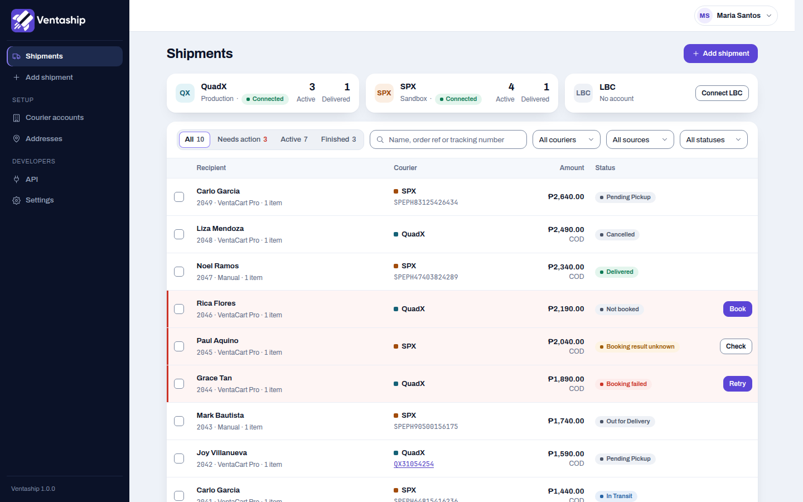

<picture>
  <source media="(prefers-color-scheme: dark)" srcset="public/brand/ventaship-logo-dark.png">
  
</picture>

**Ventaship is self-hosted shipping software for Philippine online shops.** Book parcels with **QuadX**, **SPX Express** and **LBC Express** from one dashboard, print waybills, and track every delivery, without logging in to each courier's portal.

## Multi-courier shipping for the Philippines

Ventaship connects your shop to Philippine couriers through their official APIs. Add a shipment by hand, or let your online store send its orders in. It runs on your own server, so your orders and customer data stay with you.

## Features

- Book shipments with QuadX, SPX Express and LBC Express from one place.
- Print shipping labels and waybills for one parcel or many.
- Track every parcel until it is delivered.
- See which shipments need your attention.
- Connect any online store or e-commerce platform through a simple API.

## Who it is for

Online sellers and small e-commerce businesses in the Philippines who ship with more than one courier and want one place to manage it all.

## Install

Ventaship is a Laravel app that runs on any PHP server with MySQL. See the **[install guide](docs/install.md)**.

## For developers

- The store API is described in **[docs/api.md](docs/api.md)**.
- Courier API references are in [docs/couriers](docs/couriers).
- Run the tests with `php artisan test` and `npm run test:js`.
- How versions, the changelog and releases work: **[CONTRIBUTING.md](CONTRIBUTING.md)**.

## Version

The current version is in [VERSION](VERSION), and what changed in each release is in [CHANGELOG.md](CHANGELOG.md).
