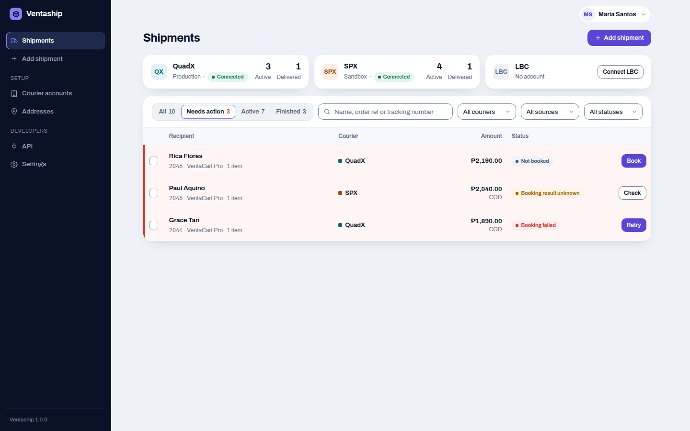
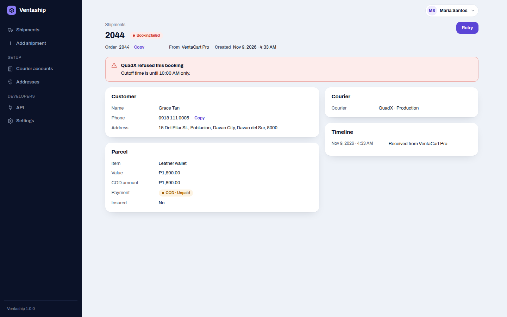
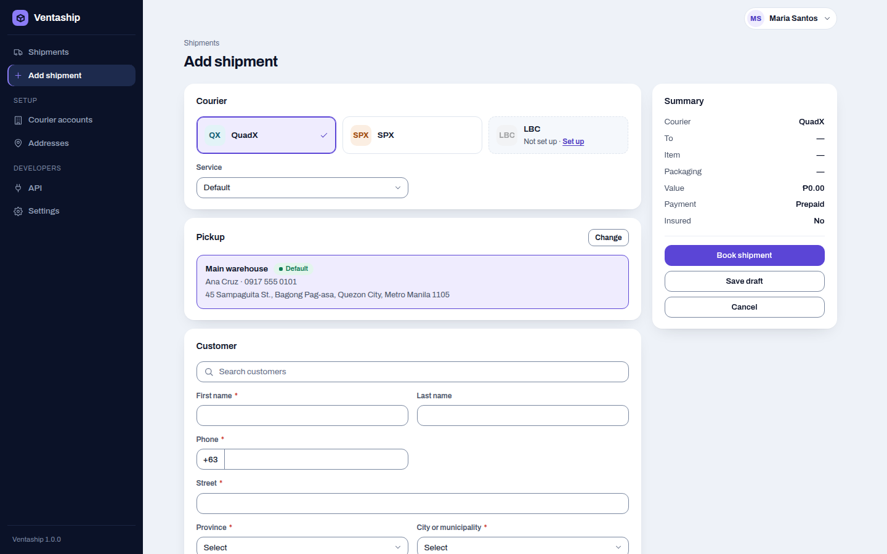
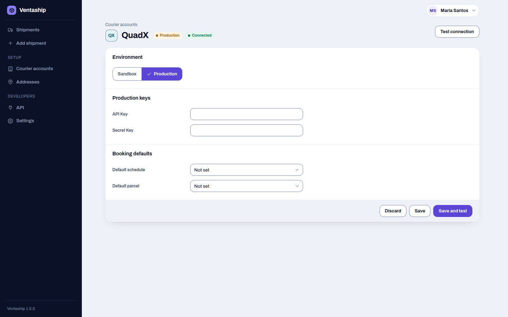
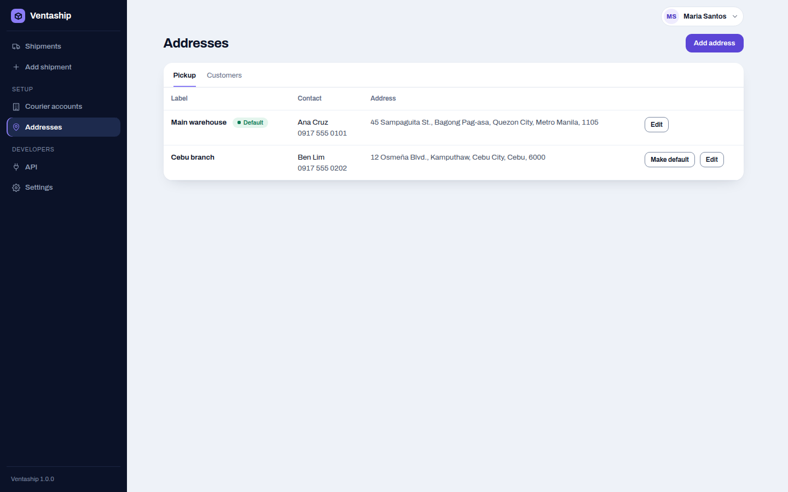
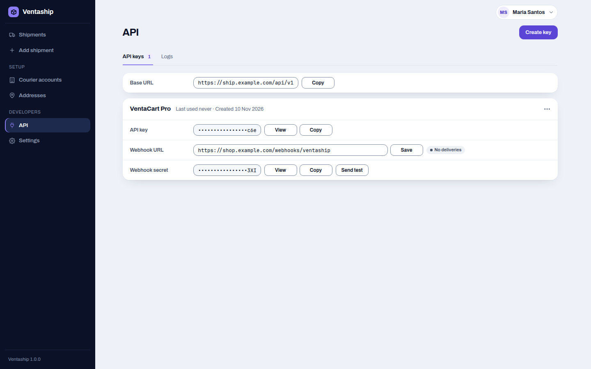
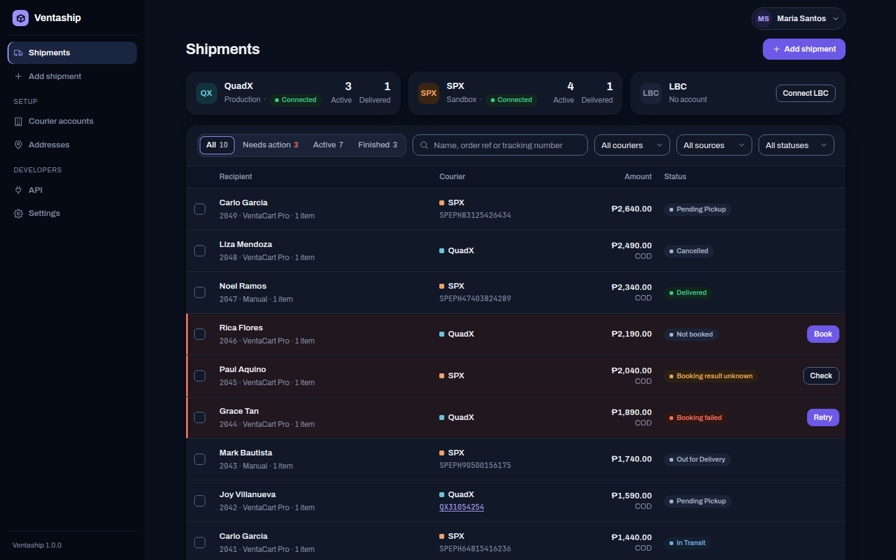
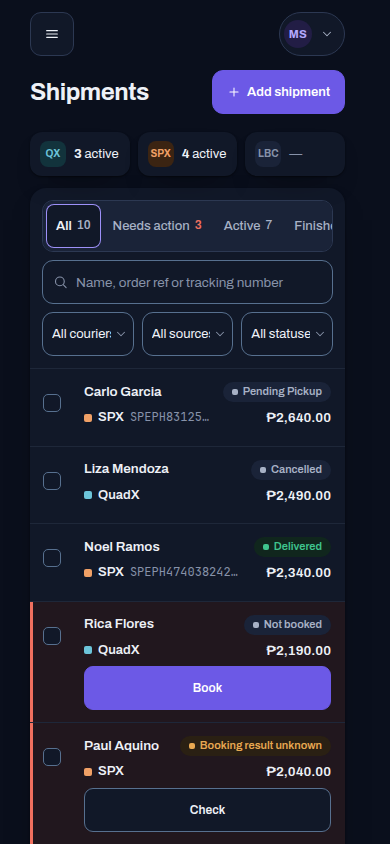

# Ventaship

Ventaship books your parcels with Philippine couriers — **QuadX**, **SPX** and **LBC** — from one place. Add a shipment by hand or let your online store send orders in, print waybills, and follow every parcel until it is delivered.

It runs on your own server. One install serves your shop and any store you connect to it.

## What you can do

- **Book shipments** with QuadX, SPX or LBC, by hand or from a connected store.
- **See everything in one list.** The *Needs action* view shows what is waiting on you: a booking a courier refused, a result you need to check, a draft to book. Search by name, order number or tracking number.
- **Fix problems in place.** A refused booking shows the courier's reason with a *Retry* button.
- **Print waybills** for one parcel or many at once.
- **Follow each parcel** with the courier's live status and a tracking link for your customer.
- **Save pickup addresses and customers** so a new shipment takes seconds. Philippine addresses are picked from province, city and barangay lists.
- **Set up each courier** with separate Sandbox and Production keys, and check them with *Save and test*.
- **Connect your stores** with API keys and webhooks. Your store can check coverage, get quotes, book, cancel and print waybills, and is told about every status change.
- **Light and dark mode**, and it works on your phone.

| | |
|---|---|
|  |  |
|  |  |
|  |  |
|  |  |

## Install

See **[docs/install.md](docs/install.md)**. In short: a PHP 8.2+ server with MySQL, `composer install`, `npm run build`, set up `.env`, run the migrations, create your admin account, and add one cron line.

## For developers

- The API your store talks to is described in **[docs/api.md](docs/api.md)**.
- Courier API references are in [docs/couriers](docs/couriers).
- Run the tests with `php artisan test` and `npm run test:js`.
- How versions, the changelog and releases work: **[CONTRIBUTING.md](CONTRIBUTING.md)**.

## Version

The current version is in [VERSION](VERSION), and what changed in each release is in [CHANGELOG.md](CHANGELOG.md).
